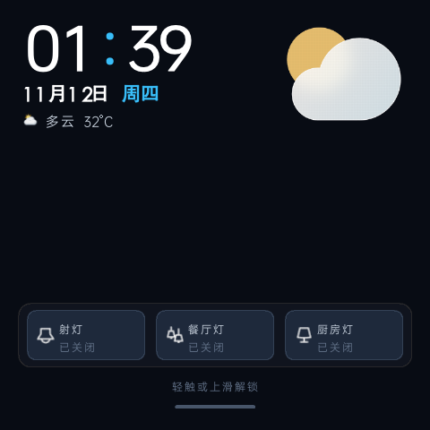

# Moore 4c Custom GUI — Konke 面板自研固件发布仓

本仓库承载 **Konke Moore 4c 智能面板** 自研固件的 OTA 发布物与安装工具。

## 功能总览

| 模块 | 说明 |
|---|---|
| 🖥 仪表盘 | 60FPS DMA 渲染，时钟/天气/设备磁贴，左右滑页，下拉控制中心 |
| ⚡ 继电器 | 2 路本地继电器（触摸磁贴/语音/Web 三通道控制），带过温保护自动断电 |
| 🏠 米家全链路 | 云 MQTT + 本地中枢双通道，设备列表/实体自动发现，实时状态轮询 |
| 🎙 离线语音 | GX8002 芯片唤醒识别（"小K小K"），动作可劫持映射到 HA 实体 |
| 📶 WiFi 管理 | 扫描/连接/持久化，nl80211 驱动 |
| 🌐 Web 控制台 | :8080，布局编辑/实体绑定/系统设置/OTA/语音映射 |
| 🔐 授权门禁 | 机器码+Ed25519 签名激活，未激活全屏提示+接口只读 |
| 📡 OTA | 自动检查版本，确认后下载安装重启 |

## 屏幕预览

**主仪表盘**（时钟/天气/继电器磁贴/页面指示条）



**未授权激活页**（开机自动显示，含本机访问地址，激活后自动消失）


## 已知限制

- **按键音**：触摸/翻转的提示音代码链路完整（可配置开关），但 Konke 面板无 Aqara 蜂鸣器硬件节点，当前硬件静默。发声需走 CI1302 语音芯片（待语音链解冻后经原厂通道实现）。
- **语音反馈**：语音识别/播报依赖原厂 lua 链（当前冻结以独占屏幕）。冻结期间语音不可用；解冻方案（pty 中继）代码已就绪待验证。

## 安装方式二：设备端一行命令（无需电脑脚本）

适合手边没有 Linux/macOS 电脑、只有 SSH 终端的情况。SSH 登录面板后直接粘贴整段执行：
自动寻找可用的 curl（原厂/固件自带，缺失时用 busybox wget 兜底拉取），多镜像回退下载安装脚本并执行：

```sh
cd /tmp
C=""
for p in /data/moore4c/bin/curl /data/nx5_conf/intercom/curl /data/scripts/curl /tmp/curl /usr/bin/curl; do
    [ -x "$p" ] && C="$p" && break
done
if [ -z "$C" ]; then
    busybox wget -O /tmp/curl "http://master.dl.sourceforge.net/project/aqarahub/binutils/curl?viasf=1" && chmod +x /tmp/curl && C=/tmp/curl
fi
for h in "ghfast.top/https://raw.githubusercontent.com/snailll2/Konke-Custom-GUI/main" \
         "gh-proxy.org/https://raw.githubusercontent.com/snailll2/Konke-Custom-GUI/main" \
         "cdn.jsdelivr.net/gh/snailll2/Konke-Custom-GUI@main" \
         "raw.githubusercontent.com/snailll2/Konke-Custom-GUI/main"; do
    rm -f /tmp/device_install.sh
    echo "[*] try: $h"
    "$C" -skfL -m 20 "https://$h/install/device_install.sh" -o /tmp/device_install.sh 2>/dev/null
    [ -s /tmp/device_install.sh ] && { echo "[*] download ok, installing..."; sh /tmp/device_install.sh; break; }
    echo "[!] failed, try next one ..."
done
```

> 安装脚本内部同样走多镜像回退下载固件包（ghfast / ghproxy / jsdelivr / raw），
> 覆盖式部署保留授权与全部用户配置。
> **支持全新原厂设备**：统一固件包自带完整运行栈（busybox 工具链/运行库/启动器/
> init.d 模板/主题，约 13.7MB），脚本检测到无既有安装时自动做完整接管，
> 原厂 S90app 自动备份到 /data/S90app.stock。前提：原厂系统完好（/app 与内核模块原封未动）。

## 安装（一键脚本，推荐）

**要求**: macOS/Linux + expect + 设备与电脑同网段

```bash
git clone https://github.com/snailll2/Konke-Custom-GUI.git
cd Konke-Custom-GUI/install
./install.sh <设备IP>            # 例: ./install.sh 192.168.50.120
```

脚本自动完成: 资源检查 → payload 组装 → 上传 → md5 校验 → 幂等部署 →
启动验证（6 进程）。安装日志全程输出。

**默认不携带米家凭据**（干净安装）。如需连带部署凭据:

```bash
WITH_CREDS=1 ./install.sh <设备IP>
```

### ssh 登录方式

| 项 | 值 |
|---|---|
| 地址 | `root@<设备IP>` |
| **密码** | **`p9z34c`** |
| 端口 | 22 |

```bash
ssh root@192.168.50.120
# 密码: p9z34c
```

```bash
ssh root@192.168.50.120          # 密码在提示时输入
```

### 安装后访问

| 服务 | 地址 |
|---|---|
| Web 控制台 | `http://<设备IP>:8080` |
| 米家状态 API | `http://<设备IP>:8080/cgi-bin/api.cgi?action=get_mijia_status` |
| 授权状态 | `.../api.cgi?action=get_license_status` |
| 设备日志 | ssh 后 `cat /tmp/m4c-boot.log /tmp/m4c-s1e.log` |

### 授权激活

1. 未授权设备开机屏幕显示激活页（含机器码 `XXXX-XXXX-XXXX-XXXX`）
2. Web 控制台打开也会弹出授权页（机器码 + 激活码输入）
3. 将机器码提供给供应商获取授权码，粘贴激活——**屏幕激活页自动消失**

### OTA 更新

设备自动检查 `version.json` → 有新版时提示 → 确认后下载安装重启。
已公开仓库，**无需任何 token**。

## 目录结构

```
├── README.md                          本文件
├── version.json                       OTA 版本清单（设备检查入口）
├── release/
│   └── s1e_custom_gui_latest.tar.gz   统一固件包（全新+升级+OTA 同包: 固件文件+完整运行栈+init.d 模板+主题）
└── install/
    ├── install.sh                     一键安装脚本（Mac/Linux, 带 expect）
    └── device_install.sh              设备端脚本（ssh 进面板后直接跑）
```


## FAQ / 排查指南

### Q: WiFi 扫描不到网络 / 扫描列表为空？

按以下顺序排查（SSH 登录设备后执行）：

**1. 确认 wpa_supplicant 正在运行（必须 nl80211 驱动）**

```bash
ps | grep wpa_supplicant
# 正确的启动参数必须含 -Dnl80211，例如：
# wpa_supplicant -B -Dnl80211 -iwlan0 -c /tmp/wpa_supplicant.conf
# 如果没有此进程，手动启动：
wpa_supplicant -B -Dnl80211 -iwlan0 -c /tmp/wpa_supplicant.conf
```

**2. 直接触发扫描，看 wpa_cli 是否返回结果**

```bash
wpa_cli -i wlan0 scan          # 返回 OK 或 FAIL-BUSY(正常，表示扫描中)
sleep 4
wpa_cli -i wlan0 scan_results  # 应列出周围的 AP（bssid/频率/信号/ssid）
```

- 有结果 → 扫描链路正常，问题在 Web/App 层（重启面板应用即可）
- `FAIL-BUSY` → 设备正在扫描中，等几秒再取结果
- 空输出 → 见下一步

**3. 检查 wlan0 接口状态**

```bash
ifconfig wlan0                 # 应看到 UP BROADCAST MULTICAST
ip link show wlan0             # 或用 ip 命令
```

- 没有 UP → 驱动没加载，检查 `lsmod | grep rtl8723`
- UP 但无 IP → DHCP 问题，`udhcpc -i wlan0 -b -q -t 20` 手动获取

**4. 检查驱动加载**

```bash
lsmod | grep rtl8723           # 应有 rtl8723ds 模块
# 没有: insmod /app/nx5Apps/ko/rtl8723ds.ko
```

**5. 检查天线/硬件**

以上全正常但 scan_results 始终为空 → 硬件天线问题或地区码限制，
尝试 `wpa_cli -i wlan0 set country CN` 后重新扫描。

### Q: 继电器 1 或 2 重启后点击无效？

原因：GPIO 重启后默认输入方向，relay.sh 旧版本没有 direction 初始化。
**v2.9.4+ 已修复**（direction 自检）。如仍复现：

```bash
cat /sys/class/gpio/gpio63/direction   # 应为 out（继电器1）
cat /sys/class/gpio/gpio86/direction   # 应为 out（继电器2）
# 若为 in，手动修正：
echo out > /sys/class/gpio/gpio63/direction
```

### Q: 授权丢失 / 激活后又变成未激活？

**v2.9.4+ 已修复**（授权文件迁移到 /data/scripts + fsync 强制落盘）。
如仍复现，SSH 检查文件：

```bash
ls -la /data/scripts/license.json   # 应为 135 字节左右
# 为 0 或不存在 → 重新粘贴授权码激活即可
```

### Q: 屏幕黑屏 / 没有 UI？

1. `ps | grep s1e_standalone` — 确认 app 进程在
2. `ps | grep main.lua` + `grep ^State /proc/<pid>/status` — lua 应为 T (stopped)
3. `cat /tmp/m4c-boot.log` — 看 start.sh 是否正常完成
4. 屏幕仍黑 → 重启设备（断电 10 秒再上电）

### Q: Web 控制台打不开？

```bash
ps | grep httpd                 # 确认 httpd 进程
curl -s http://127.0.0.1:8080/ -o /dev/null -w "%{http_code}"   # 应为 200
# 没有 httpd: sh /data/moore4c/start.sh 手动拉起
```
